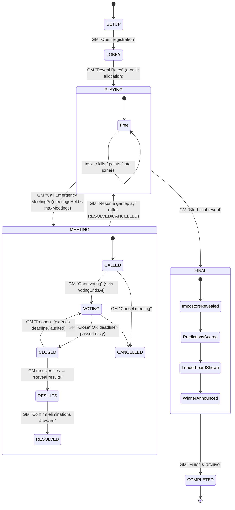

# Among Us IRL: Live Game Management, Technical Implementation Plan

**Project:** Gavel Up (SLIIT Gavel Club orientation website)
**Event date:** 21 November 2026, 9:00 AM – 12:00 PM, SLIIT Malabe (from `src/config/eventConfig.ts`)
**Plan date:** 18 November 2026
**Status:** Plan only. No code has been written.

### Source legend

Every requirement is tagged with where it came from:

| Tag | Source |
|---|---|
| **[DOC]** | `among_us_IRL.md` (original game description) |
| **[BRIEF]** | The planning brief (task prompt) |
| **[USER]** | Decisions the organiser made during planning Q&A. **These override [DOC] and [BRIEF] where they conflict.** |
| **[REC]** | My recommendation or default. Change these freely. |

---

## 1. Executive Summary

We extend the existing Next.js 14 + Tailwind site, which is static today, with a **server-authoritative live game system**. It is built from:

- **Next.js Route Handlers** (`src/app/api/**`) running as serverless functions on the **existing Vercel deployment**. [USER]
- **MongoDB Atlas** as the only datastore, accessed through **Mongoose**, with multi-document **transactions** for the critical operations. [BRIEF][REC]
- **HTTP polling with version numbers** for live updates (clients poll every 1.5–4 s and get `304 Not Modified` when nothing has changed). No WebSocket infrastructure is needed. [USER]
- **Opaque session cookies** (httpOnly, stored in Mongo) for players. **Individual name + PIN logins** for Game Masters and Team Managers. [USER]
- **Name + phone** registration for players, unique per game. Moving to a new device needs a staff-issued one-time code. [USER][REC]

The game, as finalised with the organiser:

- About **60–80 players** in **5 or fewer colour teams**. **One impostor and one detective per team** by default, configurable. **No Medic.** [USER]
- **Team points only.** There is no individual leaderboard and no "Most Outstanding Player" award. [USER]
- **One emergency meeting.** Each team votes for the impostor **within its own team**. The top-voted player in each team is eliminated (becomes a Ghost) and revealed. **The GM breaks ties.** [USER]
- In the same meeting, players may optionally make **cross-team predictions**. **The first prediction from team A about team B locks team A's prediction for team B.** Correct predictions earn team points and wrong ones cost team points. [USER]
- The Detective gets **one physical, secret question** to the GM. The GM logs it in the app. [USER]
- Sticker kills are recorded by the **GM, or by the victim's team's Team Manager**. [USER]
- Endgame: reveal impostors, show the team leaderboard and announce the winning team by points. **"Impostors win" if fewer than 2 impostors were voted out.** [USER]

**Scope and timeline risk:** the organiser chose **full scope for 21 Nov**, which leaves about 2.5 working days. Section 15 orders the work so that each phase leaves the game playable, and gives a **paper fallback** for every critical step. **A full rehearsal on 20 Nov is mandatory.**

---

## 2. Existing Codebase Assessment

### 2.1 Stack (verified by inspection)

| Area | Finding |
|---|---|
| Framework | Next.js `^14.2.18`, **App Router** (`src/app`), React 18, TypeScript 5 (`strict` per tsconfig) |
| Styling | Tailwind 3.4 with a custom theme: `among.*` crewmate colours (red, blue, green, pink, orange, yellow, black, white, purple, cyan, lime, maroon…), `space.*` palette, fonts `font-game` / `font-pixel` / `font-hud`, animations `float`, `pulse-glow`, `emergency-pulse`, shadows `neon-cyan` / `neon-red` / `card-glass` |
| Global CSS | `globals.css`: Google Fonts (Amatic SC, Press Start 2P, Share Tech Mono, Inter), `.hud-box-cyan`, `.hud-box-red` beveled HUD boxes, custom scrollbar |
| Icons / utils | `lucide-react`, `clsx`, `tailwind-merge` |
| Backend | **None.** No `api/` routes, no server actions, no database, no env vars |
| Auth | **None** |
| Registration | External **Google Form** (`eventConfig.googleFormUrl`, still a placeholder), linked from the Navbar and home CTA |
| Game Master UI | **None** |
| Deployment | Vercel (per `GUIDE.md`), `next.config.mjs` with `images.unoptimized: true` |
| Tests | None. No test runner installed |

### 2.2 Routes and components

| Path | File | Notes |
|---|---|---|
| `/` | `src/app/page.tsx` | Hero, speaker scene, register CTA, countdown, `TaskMiniGame` |
| `/about` | `src/app/about/page.tsx` | Mission |
| `/why-join` | `src/app/why-join/page.tsx` | |
| `/contact` | `src/app/contact/page.tsx` | "EMERGENCY MEETING" styled banner (reusable look) |
| Root layout | `src/app/layout.tsx` | **`"use client"`**. Renders `LoadingScreen` on **every** full load, plus `SpaceBackground`, `Navbar`, `Footer` |

Reusable components:

- `CrewmateVector`: SVG crewmate in any colour, used for **team badges and avatars**.
- `GavelUpTitle`: branding for the projector and lobby screens.
- `SpaceBackground`: shared backdrop. Make it optional on the projector for performance.
- `LoadingScreen`: keep it on marketing pages only. It **must not** run on game pages, because it delays phones mid-game.
- `Navbar` / `Footer`: marketing chrome. Game pages use a lighter `GameShell`.
- `TaskMiniGame`: styling reference for task cards and the "emergency" look.
- `lib/sounds.ts` (`SoundManager`): already has `playEmergency`, `playRoleReveal`, `playTaskComplete`, `playStart`, `playClick`, and the matching MP3s exist in `public/sounds/`. **Reuse it directly** for the meeting alarm and role reveal.
- `config/eventConfig.ts`: static marketing config. Game config goes in **MongoDB**, not here.

### 2.3 Smallest practical architecture changes

1. **Route groups** keep every existing URL and the existing look unchanged:
   - Move the current pages into `src/app/(site)/…`, with a `(site)/layout.tsx` that holds today's client layout (LoadingScreen, Navbar, Footer).
   - Add `src/app/(game)/…` with a lean `GameShell` layout: no loading screen, compact header, same background and fonts.
   - Turn the root `layout.tsx` into a **server component** that holds `<html>`, `<body>`, `globals.css` and metadata. This also lets pages export `metadata`.
2. Add `src/app/api/**` route handlers, `src/lib/server/**` (DB, models, auth, game logic), and `src/lib/shared/**` (types, zod schemas, role text).
3. Add `src/middleware.ts` for cheap redirects only. **Authorization is always enforced in the API.**
4. Add dependencies: `mongoose`, `zod`, `bcryptjs`, `qrcode` (QR generation), `libphonenumber-js` (phone normalisation). Dev dependencies: `vitest`, `mongodb-memory-server`, `@playwright/test`, `autocannon` (load).
5. Add `vercel.json` to pin the function region near Atlas (see §5.4).

Nothing is rebuilt. The marketing site stays byte-for-byte the same apart from the file moves into `(site)/`.

---

## 3. Consolidated Functional Requirements

### 3.1 Access levels

| Access level | Who | Source |
|---|---|---|
| Game Master (GM) | 2 hosts ("Admin" in [DOC]) | [DOC][BRIEF] |
| Team Manager (TM) | Exco members, one or more per team | [DOC][BRIEF] |
| Player | Audience | [DOC][BRIEF] |
| Public / Projector | Anyone, no login | [BRIEF] |

### 3.2 Characters

| Character | Count | Abilities | Source |
|---|---|---|---|
| Crewmate | Everyone else | Tasks, vote, predict | [DOC] |
| Impostor | **1 per team** (configurable, with per-team overrides) | Physical sticker kills. **Sees the list of all impostors** | [DOC][BRIEF] |
| Detective | **1 per team** (configurable) | **One** secret physical question to the GM ("Is X an impostor?"), which the GM logs in the app | [USER] overrides [DOC] (3 questions) and [BRIEF] (digital) |
| ~~Medic~~ | **Removed** | — | [USER] overrides [DOC][BRIEF] |

### 3.3 Requirement list

**Registration**

- R1. Registration desk QR code → `/play/register?g=<gameCode>`. [DOC][BRIEF]
- R2. The player enters their name and phone, and picks the team colour the desk assigned. [BRIEF][USER]
- R3. A phone number registers only once per game. A persistent httpOnly session is created. [BRIEF][USER]
- R4. GMs see registrations live. [BRIEF]
- R5. Registration can stay open after roles are revealed. Late joiners get a role without anyone else's role changing. [BRIEF]
- R6. Staff can fix a player's name or team, and remove duplicate or junk registrations. [REC]
- R7. Moving to a new device needs a one-time code issued by a GM or TM. The old sessions are revoked. [REC] (reduces the impersonation weakness of name + phone)

**Roles**

- R8. The GM presses **Reveal Roles**. The server allocates roles atomically and idempotently. [DOC][BRIEF]
- R9. Each player sees only their own role, with its description, objective, abilities, how to earn points, and instructions. [DOC][BRIEF]
- R10. Impostors see the names and team colours of all impostors (`impostorsSeeEachOther: true`). [DOC]
- R11. Roles never appear in any public, team-manager or other-player response. [BRIEF]

**Tasks and points**

- R12. The GM creates tasks ahead of time (individual, team, paired, activity) and **reveals** them when ready (the "Tasks reveal" button). [DOC][BRIEF]
- R13. Tasks can be assigned to all players, specific players, teams, or auto-generated pairs (for example, "Talk to <name> for 2 minutes"). [DOC][BRIEF]
- R14. Players mark tasks complete. Paired tasks need **both** players to confirm. Tasks can optionally require TM or GM verification. [DOC][BRIEF]
- R15. **All points are team points.** A completed task awards its team points once. [USER]
- R16. GMs and TMs award or deduct points manually, for example for table topics and Q&A. A TM can only do this for their own team and only within configured limits. [DOC][BRIEF]
- R17. Every point change is an immutable transaction. Corrections are reversal transactions. [BRIEF]
- R18. Duplicate awards are impossible: each transaction has a unique idempotency key. [BRIEF]

**Eliminations**

- R19. A GM, or the victim's team TM, marks a player as killed, which makes them a **Ghost**. Only a GM can undo a kill. [USER]
- R20. Ghosts cannot vote or predict. They **can** do tasks and earn team points. Their role is kept for the endgame. [DOC][BRIEF]
- R21. All eliminations and reversals are audit-logged. [BRIEF]

**Detective**

- R22. The GM records a Detective's investigation (detective, target). The app shows the GM the true answer, which the GM says out loud privately. The investigation limit (default **1**) is enforced. [USER]
- R23. The Detective's dashboard shows "Investigations remaining: N". [REC]

**Emergency meeting and voting**

- R24. The GM controls the lifecycle: Call meeting → Open voting (with timer) → Close voting → Resolve ties → Reveal results → Confirm eliminations → Resume. [BRIEF]
- R25. Default `maxMeetings = 1`, configurable up to more. [USER]
- R26. **Internal vote:** each alive player votes once for an alive member of their own team (not themselves). A configurable **Skip** option exists. [BRIEF][USER]
- R27. The GM sees who has and hasn't voted, by name and team, and the live tally. [DOC][BRIEF]
- R28. The top-voted player in each team is eliminated and revealed as impostor or crewmate. The **GM breaks ties**, and can choose "no elimination" for a team. [USER]
- R29. **Cross-team prediction (optional):** an alive player names a player in another team. The **first prediction by any member of team A about team B locks it for team A**. Teammates see that it is locked. [USER]
- R30. Predictions never eliminate anyone. They are stored separately from votes. The GM decides when they are scored and revealed (default: at the final reveal). [BRIEF]

**Endgame**

- R31. GM controls: Reveal all impostors → Score predictions → Final team leaderboard → Announce winning team → "Impostors win / Crew wins" → Stats → Complete and archive. [DOC][BRIEF][USER]
- R32. **Impostors win if fewer than `impostorWinThreshold` (default 2) impostors were voted out.** [USER]
- R33. ~~Most outstanding player~~: **not required**. [USER]

**Information and display**

- R34. A public rules page: characters, scoring, voting, schedule. No secrets. [BRIEF]
- R35. A projector display at `/display` shows only safe data, and its screens are switched by the GM. [BRIEF]
- R36. GM announcements are shown to all players. [BRIEF]

---

## 4. Non-Functional Requirements

| ID | Requirement | Target |
|---|---|---|
| NF1 | Concurrency | 80 players + 10 staff + 1 projector polling at the same time. Registration burst of ~20/min at the desk |
| NF2 | Latency | Phase changes reach every phone within **≤ 4 s** (≤ 2 s during voting) |
| NF3 | Correctness | The server is authoritative for roles, votes, points, timers and phases. All invariants are enforced by unique indexes or conditional updates |
| NF4 | Resilience | Refresh, reconnect, function cold start or redeploy never lose or corrupt state. All state lives in Mongo |
| NF5 | Privacy | No role, vote choice or prediction leaks before an authorised reveal. Phone numbers are visible only to GMs |
| NF6 | Mobile-first | Works on low-end Android Chrome and iOS Safari at 360 px wide. Tap targets ≥ 44 px |
| NF7 | Simplicity | One deployable app, one database, no extra realtime vendor |
| NF8 | Auditability | Every staff mutation is written to `auditLogs` with actor, before and after |
| NF9 | Recoverability | Every GM action can be undone or compensated (revive, reverse transaction, invalidate vote, reopen voting) |
| NF10 | Data minimisation | Collect only name, phone and team. Delete phones within 30 days ([REC]) |

---

## 5. Architecture Recommendation

### 5.1 Options considered

| Concern | Options | Choice |
|---|---|---|
| Backend | (a) Next.js Route Handlers on Vercel, (b) separate Express or Nest service, (c) Server Actions only | **(a)**. Same repo and deploy. Route Handlers are easier to test and to call from polling than Server Actions |
| Realtime | WebSockets/Socket.IO (needs a long-running server, which Vercel doesn't provide), SSE (Vercel functions have execution time limits, so streams get cut), Pusher/Ably (extra vendor), **polling** | **Polling + version numbers** [USER]. With 80 clients this is about 30–55 req/s, each usually a single indexed read that returns `304` |
| ODM | Native `mongodb` driver, **Mongoose** | **Mongoose**: declarative schemas and indexes, validation and transactions, and familiar to most developers. Request bodies are validated with **zod** at the edge of each handler |
| Sessions | JWT in a cookie, NextAuth, **opaque token + `sessions` collection** | **Opaque token**: revocable immediately (needed for device recovery and kicking out impostors), no extra libraries |
| Staff auth | Shared passcodes, Google OAuth, **individual PINs** | **Individual name + 6-digit PIN**, hashed with bcrypt [USER] |
| Timers | Background workers or cron (not available or reliable on serverless) | **Deadline timestamps** (`votingEndsAt`). The server checks deadlines whenever a request arrives, and closing is idempotent. No background process |
| QR | `qrcode` npm package, rendered on `/gm/qr` and printable | |
| Hosting | Vercel (existing) + **MongoDB Atlas** in the closest region | |

### 5.2 Architecture diagram

```
 ┌───────────────────────────── Phones / Laptops / Projector ─────────────────────────────┐
 │  /play (Player)     /tm (Team Mgr)     /gm (Game Master)     /display (Projector)     │
 │      │ poll 1.5–4s        │ poll 3s          │ poll 2s              │ poll 3s           │
 │      │ + POST actions     │ + POST           │ + POST               │ GET only          │
 └──────┼────────────────────┼──────────────────┼──────────────────────┼──────────────────┘
        │  HTTPS, httpOnly session cookie (SameSite=Lax, Secure)       │
 ┌──────▼──────────────────────────────────────────────────────────────▼──────────────────┐
 │                  Vercel: Next.js 14 App Router (single project)                        │
 │  (site)/ marketing pages (unchanged)      (game)/ game pages (client components)       │
 │  /api/public/*   /api/player/*   /api/staff/*   /api/gm/*   (Route Handlers, Node rt)  │
 │        │ zod validate → authenticate (sessions) → authorize (role/team) →             │
 │        │ game service (transactions, conditional updates) → audit → bump game.version │
 │        │ → DTO mapper per audience (player / tm / gm / display)                        │
 └────────┼───────────────────────────────────────────────────────────────────────────────┘
          │ Mongoose (cached connection across warm invocations, maxPoolSize 10)
 ┌────────▼───────────────────────────────────────────────────────────────────────────────┐
 │  MongoDB Atlas (replica set → transactions)  region: AWS ap-south-1 (Mumbai)           │
 │  games teams players staff sessions loginCodes tasks taskAssignments meetings votes    │
 │  predictions pointTransactions eliminations investigations announcements auditLogs     │
 └────────────────────────────────────────────────────────────────────────────────────────┘
```

### 5.3 Server code layout

```
src/
  middleware.ts                    # cookie-presence redirects for /play, /gm, /tm (UX only)
  lib/
    server/
      db.ts                        # cached mongoose connect (globalThis cache)
      models/*.ts                  # one file per collection (§6)
      auth/session.ts              # create/verify/revoke sessions, cookie helpers
      auth/guards.ts               # requirePlayer, requireStaff('GM'|'TM'), requireTeamAccess
      dto/{player,tm,gm,display}.ts# THE ONLY place responses are shaped (privacy boundary)
      game/state.ts                # snapshot builders + lazy timer evaluation
      game/roles.ts                # allocation algorithm (pure) + reveal service
      game/meeting.ts              # lifecycle, tally, tie handling, confirm
      game/scoring.ts              # transactions, idempotency keys, team totals
      game/tasks.ts                # assignment generation (pairs), completion flow
      audit.ts, rateLimit.ts, errors.ts, version.ts (bumpVersion)
    shared/
      types.ts, schemas.ts (zod), roleContent.ts (role texts), constants.ts
```

### 5.4 Hosting and deployment

- **Atlas:** create the cluster in **AWS ap-south-1 (Mumbai)**, the closest region to Sri Lanka. **Do not rely on the free M0 tier on event day.** It has throughput and connection limits, and no built-in backups. Check Atlas's current tier limits, and use **Flex** or a small dedicated tier for 20–21 Nov (a few dollars), downgrading afterwards. [REC]
- **Vercel:** set `vercel.json` → `{ "regions": ["bom1"] }` so functions run next to Atlas.
  - Estimated load: 80 players × 1 poll/3 s × 3 h ≈ **290k invocations**, plus staff traffic.
  - Check the current Hobby plan limits (invocations and active CPU), and the team's acceptable-use terms, before the event. Use a Pro trial if you're close to a limit.
- **Env vars:** `MONGODB_URI`, `SESSION_COOKIE_NAME`, `BOOTSTRAP_GM_NAME`, `BOOTSTRAP_GM_PIN` (used once by the seed script), `PUBLIC_BASE_URL` (for the QR code).
- **Seed script:** `npm run seed`, using `tsx scripts/seed.ts`. It creates the game, teams, the first GM, a sample task bank and indexes, and is idempotent.
- **Atlas network access:** Vercel uses dynamic IPs, so the allow-list needs `0.0.0.0/0`. Compensate with a strong DB user password and a least-privilege `readWrite` role on one database.

---

## 6. MongoDB Data Model

All documents carry `gameId` so that a future event (or a rehearsal game) is fully isolated. **The rehearsal uses a separate game code** and is archived before the real event.

### 6.1 `games` (one document per event or rehearsal)

```ts
{
  _id: ObjectId,
  code: "GAVELUP26",                 // unique; appears in QR URL
  name: "Gavel Up 2026",
  phase: "SETUP" | "LOBBY" | "PLAYING" | "MEETING" | "FINAL" | "COMPLETED",   // §7
  registrationOpen: boolean,
  version: number,                   // ++ on EVERY state mutation (drives polling)
  rolesRevealedAt: Date | null,
  revealLock: { by: ObjectId, at: Date } | null,      // concurrency guard for reveal
  activeMeetingId: ObjectId | null,                    // at most one active meeting
  meetingsHeld: number,
  display: { screen: "LOBBY"|"REGISTRATION"|"RULES"|"MEETING"|"VOTING"|"RESULTS"
                     |"IMPOSTORS"|"LEADERBOARD"|"WINNER"|"STATS", updatedAt: Date },
  final: {
    impostorsRevealedAt?: Date, predictionsScoredAt?: Date,
    leaderboardShownAt?: Date, winnerAnnouncedAt?: Date,
    winningTeamIds?: ObjectId[], impostorsWin?: boolean, impostorsVotedOut?: number
  },
  config: {
    impostorsPerTeam: 1, impostorOverrides: { [teamId: string]: number },
    detectivesPerTeam: 1, minTeamSizeForSpecialRoles: 3,
    impostorsSeeEachOther: true,
    lateJoinerRole: "crewmate",          // never auto-assign specials late
    detectiveInvestigationLimit: 1,
    maxMeetings: 1, votingDurationSec: 180, voteGraceSec: 3, allowSkipVote: true,
    predictionsEnabled: true, predictionsRevealAt: "FINAL" | "MEETING_RESULTS",
    impostorWinThreshold: 2,             // impostors win if votedOut < threshold
    winningTeamTieRule: "SHARED",        // or "GM_DECIDES"
    points: {
      taskDefault: 10, pairedTaskDefault: 15,
      correctInternalVotePerVoter: 10,   // team gets +10 per member who voted for the real impostor
      correctPrediction: 30, wrongPrediction: -15,
      tmManualMin: -20, tmManualMax: 20, gmManualMin: -100, gmManualMax: 100
    },
    poll: { idleMs: 4000, activeMs: 3000, votingMs: 1500 }
  },
  createdAt, updatedAt, archivedAt: Date | null
}
```
Indexes: `{ code: 1 } unique`.

### 6.2 `teams`

```ts
{ _id, gameId, key: "red", name: "Red", colorHex: "#C51111", order: 1,
  score: 0,               // denormalised cache, updated in the same transaction as each pointTransaction
  createdAt }
```
Indexes: `{ gameId: 1, key: 1 } unique`. The 5 default colours come from the existing `among.*` palette: red, blue, green, yellow, purple. [REC]

### 6.3 `players`

```ts
{
  _id, gameId, teamId,
  name: "Nimal Perera", nameNormalized: "nimal perera",
  phoneE164: "+94771234567",          // normalised with libphonenumber-js, default region LK
  status: "alive" | "ghost",
  role: null | "crewmate" | "impostor" | "detective",   // NEVER returned except via dto/player (self) & GM
  roleAssignedAt: Date | null, roleSource: "reveal" | "late" | "gm_override" | null,
  eliminatedAt: Date | null, eliminationCause: null | "kill" | "vote" | "gm",
  investigationsUsed: 0,              // detectives only
  removedAt: Date | null,             // soft-delete for junk/duplicate registrations
  registeredAt, updatedAt
}
```
Indexes:
- `{ gameId: 1, phoneE164: 1 } unique`, which prevents duplicate registration.
- `{ gameId: 1, teamId: 1, status: 1 }`
- `{ gameId: 1, role: 1 }`

**Why the role lives on the player document:** it keeps reveal, voting and scoring simple (no join needed). Privacy is enforced by (1) Mongoose `select: false` on `role`, so it has to be requested explicitly, and (2) the DTO layer, (3) checked by privacy tests (§14). This is a deliberate consolidation instead of a separate `roleAssignments` collection.

### 6.4 `staff`

```ts
{ _id, name: "Kasun", nameNormalized, role: "GM" | "TM",
  teamIds: ObjectId[],                // TMs: assigned teams; GMs: []
  pinHash: string, active: true, failedAttempts: 0, lockedUntil: Date | null,
  createdBy, createdAt }
```
Indexes: `{ nameNormalized: 1 } unique`.

### 6.5 `sessions`

```ts
{ _id, tokenHash: sha256(token), subjectType: "player" | "staff", subjectId, gameId,
  createdAt, lastSeenAt, expiresAt, revokedAt: Date | null, userAgent }
```
Indexes:
- `{ tokenHash: 1 } unique`
- `{ subjectId: 1 }`
- `{ expiresAt: 1 }` TTL (expireAfterSeconds 0)

Player sessions last 2 days and staff sessions 12 hours.

### 6.6 `loginCodes` (device recovery)

```ts
{ _id, playerId, gameId, codeHash, issuedBy: staffId, expiresAt (+10 min), usedAt: null }
```
Indexes: `{ expiresAt: 1 }` TTL, `{ playerId: 1 }`.

### 6.7 `tasks` (task definitions)

```ts
{ _id, gameId, title, description,
  kind: "individual" | "team" | "paired" | "activity",
  points: number, verification: "none" | "partner" | "staff",
  pairing: { scope: "same_team" | "cross_team" } | null,
  allowGhosts: true,
  revealed: false, revealedAt: Date | null,
  order: number, active: true, createdBy, createdAt }
```
Indexes: `{ gameId: 1, revealed: 1, order: 1 }`.

`activity` covers table topics, Q&A and icebreakers. These aren't self-completed: staff award points against the activity through the manual award flow, with the activity linked for reporting.

### 6.8 `taskAssignments` (assignments and completions combined)

```ts
{ _id, gameId, taskId, teamId,       // team that earns the points (for paired cross-team: one doc per player's team)
  assigneeIds: ObjectId[],           // [p] individual, [] team-wide, [a,b] paired
  assignmentKey: string,             // "p:<id>" | "t:<teamId>" | "pair:<minId>:<maxId>"
  status: "open" | "awaiting_partner" | "awaiting_verification" | "completed" | "rejected",
  confirmations: [{ playerId, at }],
  verifiedBy: staffId | null, verifiedAt, rejectReason,
  transactionIds: ObjectId[],
  createdAt, updatedAt }
```
Indexes:
- `{ gameId: 1, taskId: 1, assignmentKey: 1 } unique`, so the same task can't be assigned twice.
- `{ gameId: 1, assigneeIds: 1 }`
- `{ gameId: 1, teamId: 1, status: 1 }`

**Cross-team pairs:** the pair is one assignment, but each player's **own team** earns the points. That gives two transactions with keys `task:<assignmentId>:team:<teamId>`.

### 6.9 `meetings`

```ts
{ _id, gameId, number: 1,
  status: "CALLED" | "VOTING" | "CLOSED" | "RESULTS" | "RESOLVED" | "CANCELLED",
  calledAt, calledBy,
  votingOpenedAt, votingEndsAt, votingClosedAt,
  eligible: [{ teamId, voterIds: ObjectId[], candidateIds: ObjectId[] }],   // snapshot at open
  teamResults: [{
    teamId, tally: [{ playerId, count }], skipCount, notVotedCount,
    topCandidateIds: ObjectId[], tie: boolean,
    decision: { eliminatedPlayerId: ObjectId | null, decidedBy: "auto" | staffId, at } | null,
    wasImpostor: boolean | null
  }],
  resultsRevealedAt, resolvedAt, resolvedBy }
```
Indexes: `{ gameId: 1, number: 1 } unique`. The "only one active meeting" rule is enforced through `games.activeMeetingId` with a conditional update.

### 6.10 `votes` (internal team votes)

```ts
{ _id, gameId, meetingId, teamId, voterId,
  targetId: ObjectId | null,          // null = skip
  createdAt, invalidatedAt: null, invalidatedBy, invalidReason }
```
Indexes: `{ meetingId: 1, voterId: 1 } unique`, which makes it **one vote per round**. Also `{ meetingId: 1, teamId: 1 }`.

Votes are **final once cast** ([REC]). Allowing changes complicates "who has voted" and invites last-second manipulation.

### 6.11 `predictions` (cross-team, separate from votes)

```ts
{ _id, gameId, meetingId,
  predictorTeamId, predictorPlayerId,
  targetTeamId, targetPlayerId,
  createdAt,
  outcome: null | "correct" | "wrong", scoredAt, transactionId,
  invalidatedAt: null, invalidatedBy, invalidReason }
```
Indexes:
- `{ meetingId: 1, predictorTeamId: 1, targetTeamId: 1 } unique`. This **is** the rule that the first prediction locks it for the team. [USER]
- `{ meetingId: 1, predictorPlayerId: 1 }`

### 6.12 `pointTransactions` (the ledger, the single source of scoring truth)

```ts
{ _id, gameId, teamId,
  amount: number,                     // signed
  category: "task" | "activity" | "manual" | "internal_vote" | "prediction" | "penalty" | "reversal",
  reason: string,
  earnedByPlayerId: ObjectId | null,  // attribution only (stats); no individual leaderboard
  source: { type: "taskAssignment" | "meeting" | "prediction" | "manual" | "task", id: ObjectId | null },
  idempotencyKey: string,             // see §11.4
  createdBy: { type: "system" | "staff" | "player", id, name },
  reversesId: ObjectId | null, reversedById: ObjectId | null,
  createdAt }
```
Indexes:
- `{ gameId: 1, idempotencyKey: 1 } unique`
- `{ gameId: 1, createdAt: -1 }`
- `{ gameId: 1, teamId: 1 }`

`teams.score` is a cache. `scripts/recompute-scores.ts` (and a GM button) rebuilds it as the sum of transactions.

### 6.13 `eliminations`

```ts
{ _id, gameId, playerId, teamId, cause: "kill" | "vote" | "gm",
  meetingId: ObjectId | null, recordedBy: staffId | "system", note,
  createdAt, revertedAt: null, revertedBy, revertReason }
```
Index: `{ gameId: 1, playerId: 1, createdAt: -1 }`.

### 6.14 `investigations` (Detective)

```ts
{ _id, gameId, detectiveId, targetId, answerIsImpostor: boolean, recordedBy, createdAt }
```
The limit is enforced by a conditional increment on `players.investigationsUsed` (§8.3).

### 6.15 `announcements`

```ts
{ _id, gameId, text, level: "info" | "alert", audience: { type: "all" } | { type: "team", teamId },
  createdBy, createdAt, pinned: boolean, deletedAt: null }
```

### 6.16 `auditLogs`

```ts
{ _id, gameId, actor: { type, id, name }, action: "ROLES_REVEALED" | "PLAYER_KILLED" | ...,
  target: { type, id }, before: object | null, after: object | null,
  requestId, ip, createdAt }
```
Index: `{ gameId: 1, createdAt: -1 }`. Visible to GMs only. Never deleted during the event.

### 6.17 Collections not created

| Brief entity | Decision |
|---|---|
| Medic protections | **Dropped** [USER]. Can be added later as `protections` |
| Roles / role assignments | Folded into `players.role` (§6.3) |
| Task completions | Folded into `taskAssignments` |
| Game configuration | Embedded in `games.config` |
| Emergency meetings | `meetings` |

### 6.18 Concurrency and idempotency summary

| Risk | Protection |
|---|---|
| Double registration | Unique `{gameId, phoneE164}`. A retry from the **same session** returns the existing player (200). A different session gets `409` |
| Double Reveal click / two GMs at once | `findOneAndUpdate({_id, rolesRevealedAt:null, revealLock:null}, {$set:{revealLock}})` → allocate in a **transaction** → set `rolesRevealedAt`, clear the lock. A second caller gets `200 {alreadyRevealed:true}` or `409 REVEAL_IN_PROGRESS`. A stale lock (>60 s) can be cleared by a GM |
| Double vote | Unique `{meetingId, voterId}`. A duplicate key returns the existing vote (200, idempotent) |
| Prediction race between teammates | Unique `{meetingId, predictorTeamId, targetTeamId}`. The loser gets `409 PREDICTION_LOCKED` with the locked target |
| Duplicate point award | Unique `{gameId, idempotencyKey}`, and the transaction write and `teams.score $inc` happen in **one Mongo transaction** |
| Two meetings at once | `findOneAndUpdate({_id, activeMeetingId:null, phase:"PLAYING"}, …)` |
| Phase transitions | Every transition is a conditional update on the expected current phase or status (compare-and-set) |
| Detective over-limit | `findOneAndUpdate({_id, role:"detective", investigationsUsed:{$lt:limit}}, {$inc:{investigationsUsed:1}})` inside the transaction that inserts the investigation |

---

## 7. Game State Machine

### 7.1 Diagram



`registrationOpen` is an **independent flag** that can be toggled in LOBBY, PLAYING and MEETING. [BRIEF]

### 7.2 Transitions

| From → To | Trigger | Validations | Side effects | Player UI |
|---|---|---|---|---|
| SETUP → LOBBY | GM "Open registration" | ≥2 teams exist | `registrationOpen=true` | Register form works |
| LOBBY → PLAYING | GM **Reveal Roles** (type-to-confirm `REVEAL`) | ≥1 player per team. Warn (not block) if a team has fewer than `minTeamSizeForSpecialRoles` | Allocation (§11.1), `rolesRevealedAt`, display→RULES | Full-screen **role reveal** animation + `playRoleReveal()`, shown once (stored in localStorage `seenReveal:<gameId>`). The role card stays available afterwards |
| PLAYING → MEETING | GM **Emergency Meeting** | `activeMeetingId==null`, `meetingsHeld<maxMeetings` (the GM can override with confirmation) | Create the meeting (CALLED), display→MEETING | Red **EMERGENCY MEETING** overlay + `playEmergency()`. "Discuss with your team" |
| CALLED → VOTING | GM **Open voting** (duration input, default 180 s) | — | Snapshot of eligible voters and candidates per team. `votingEndsAt=now+duration` | Vote panel + countdown. Prediction panel (optional tab) |
| VOTING → CLOSED | GM **Close voting**, or deadline + grace has passed (the first request after that closes it, idempotently) | — | Compute tallies, `topCandidateIds`, `tie` | "Voting closed — awaiting results" |
| CLOSED → VOTING | GM **Reopen** (extra seconds) | Results not yet revealed | Audit entry | Vote panel returns for anyone who hasn't voted |
| CLOSED → RESULTS | GM **Reveal results** | Every tied team has a GM decision | Display→RESULTS, per-team eliminated player + impostor/crewmate | Your team's result card |
| RESULTS → RESOLVED | GM **Confirm** | — | Eliminated players → ghost (cause `vote`). Internal-vote points awarded (idempotent). `meetingsHeld++` | Ghost status for the eliminated |
| MEETING → PLAYING | GM **Resume** | Status RESOLVED or CANCELLED | `activeMeetingId=null` | Normal dashboard |
| PLAYING → FINAL | GM **Start final reveal** | No active meeting | Voting and predictions disabled. Tasks frozen ([REC]) | "Final reveal in progress — watch the screen" |
| FINAL steps | GM buttons, in order | Each step requires the previous one | See §11.5 | Their own team's standing. After the impostor reveal, all roles become public |
| FINAL → COMPLETED | GM **Finish & archive** (type `FINISH`) | Winner announced | `registrationOpen=false`. All mutations rejected (`423 GAME_ARCHIVED`) | Read-only results |

### 7.3 Refresh, reconnect and restart safety

- **No in-memory state.** Every request reads Mongo. Serverless cold starts and redeploys don't matter.
- Timers are **absolute timestamps**. Clients compute `remaining = votingEndsAt − (Date.now() + serverOffset)`, where `serverOffset` comes from `serverTime` in each snapshot.
- Closing is **lazy and idempotent**: any request that sees `status=VOTING && now > votingEndsAt + grace` runs a CAS update to CLOSED and computes the tally. The GM's "Close" uses the same function.
- Reveal-animation-seen and the selected tab are UI-only flags in `localStorage`. Losing them only replays an animation.

---

## 8. Frontend Page and Component Plan

### 8.1 Route structure

```
src/app/
  layout.tsx                       # SERVER: <html>, <body>, globals.css, metadata
  (site)/                          # existing pages — moved, unchanged URLs
    layout.tsx                     # "use client": LoadingScreen + SpaceBackground + Navbar + Footer (today's layout)
    page.tsx, about/, why-join/, contact/
    how-to-play/page.tsx           # NEW public rules page (R34)
  (game)/
    layout.tsx                     # GameShell: SpaceBackground (lite), compact HUD header, ConnectionStatus
    play/page.tsx                  # Player dashboard (redirect to /play/register if no session)
    play/register/page.tsx         # QR landing: name, phone, team colour picker
    play/recover/page.tsx          # enter phone + staff-issued code
    staff/login/page.tsx           # name + PIN
    tm/page.tsx                    # Team Manager: roster, kills, verify tasks, award points, recovery codes
    gm/page.tsx                    # GM live dashboard (overview + primary controls)
    gm/players/page.tsx            # registrations (live), edit, remove, roles, kill/revive, detective log
    gm/tasks/page.tsx              # task bank, reveal, assign, verification queue
    gm/meeting/page.tsx            # meeting control room (vote monitor, ties, results)
    gm/points/page.tsx             # ledger, manual award, reversal
    gm/endgame/page.tsx            # final reveal sequence
    gm/setup/page.tsx              # teams, staff & PINs, config
    gm/qr/page.tsx                 # printable registration QR
    gm/audit/page.tsx              # audit log
  display/page.tsx                 # projector — outside both groups: no navbar, full-screen, large type
  api/...                          # §9
```

**Navbar:** add a "How to Play" link. On event day, change the "Register Now" CTA to `/play/register` through a new `eventConfig.liveGameRegistrationEnabled` flag. Until then it stays on the Google Form ([REC], see §17).

### 8.2 Shared game components (`src/components/game/`)

| Component | Purpose | Reuses |
|---|---|---|
| `GameShell` | Header with logo, team badge, phase chip, mute toggle, connection dot | `Navbar` styles, `sounds` |
| `HudCard` | Panel wrapper (`variant="cyan" or "red"`) | `.hud-box-cyan/red`, `card-glass` |
| `TeamBadge` / `PlayerChip` | Colour crewmate + name | `CrewmateVector` |
| `PhaseBanner` | Current phase + instructions | |
| `RoleCard` | Role name, art, description, objective, abilities, how to score. Has a "hold to reveal" blur so nobody can read it over the player's shoulder | `imposter.png`, `CrewmateVector` |
| `RoleRevealOverlay` | One-time animated reveal | `playRoleReveal`, `shh.jpg` |
| `ImpostorAllies` | Impostor-only list of fellow impostors | |
| `EmergencyOverlay` | Meeting alarm screen | `emergency-pulse`, `playEmergency` |
| `CountdownTimer` | Server-synced countdown | Home page countdown styling |
| `VotePanel` | Big tappable candidate list (own team, alive, not self) + Skip + **confirm sheet** + "Vote recorded ✓" | |
| `PredictionPanel` | Per-other-team picker. Shows "Locked by <teammate>: <target>" when locked | |
| `TaskList` / `TaskCard` | Status chips, partner name, "Mark complete" / "Confirm" / "Awaiting verification" | `TaskMiniGame` look, `playTaskComplete` |
| `TeamScoreCard`, `Leaderboard`, `PointsFeed` | Scores and recent transactions | |
| `VoteMonitor` | GM: per-team voted / not-voted lists + live bars | |
| `ConfirmDialog` | Standard confirm. **Type-to-confirm** variant for irreversible actions | |
| `PlayerPicker` | Searchable list (staff) | |
| `ConnectionStatus` | Online / reconnecting / offline banner | |
| `StateViews` | `Loading`, `Waiting` ("Roles not revealed yet — stay tuned"), `Error`, `SessionExpired` (link to recovery), `Archived` | |

### 8.3 Client data hook

`useGameState(endpoint)`:

- Polls `GET endpoint?v=<lastVersion>` and handles `304`.
- Interval comes from `config.poll`: `votingMs` while the meeting is VOTING, `activeMs` during a meeting, `idleMs` otherwise.
- Slows down when the tab is hidden (`document.visibilityState`), and refetches immediately when it's visible again or after `online`.
- Backs off exponentially (max 15 s) on errors and shows `ConnectionStatus`.
- Keeps the last good snapshot so the UI never blanks.
- Exposes `mutate(action)`, which POSTs then refetches immediately.

### 8.4 Role-specific player UI

| Phase | Crewmate | Impostor | Detective | Ghost overlay |
|---|---|---|---|---|
| LOBBY | Waiting card + team + rules link | same | same | — |
| PLAYING | Role card, tasks, team score, announcements | + allies list, "Use stickers discreetly" rules | + "Investigations remaining: 1. Ask a host privately" | Grey ghost styling. Vote and predict hidden. "You can still do tasks for your team" |
| MEETING | Vote + optional predictions | same (voting among own team, can vote for anyone) | same | "Ghosts can't vote" |
| FINAL / COMPLETED | Team results, revealed impostors, win banner | same | same | same |

### 8.5 GM controls and safety

- **Primary action bar** on `/gm`: Open/Close Registration · Reveal Roles · Reveal Tasks · Emergency Meeting · Final Reveal. The bar shows only the actions valid in the current phase.
- **Type-to-confirm:** Reveal Roles, Confirm eliminations, Start final reveal, Finish & archive.
- **Simple confirm:** Call meeting, Open/Close voting, Kill, Revive, Award points >20, Reverse transaction.
- Each control shows **who else is a GM online** (from staff session `lastSeenAt`) so the two hosts don't both press buttons.
- Every mutation sends `expectedVersion`. A stale version gives `409 STALE_STATE` with "State changed — review and retry" (§9.1).

### 8.6 Projector (`/display`)

The GM drives which screen shows through `games.display.screen`.

- **Safe data only:** registration count, per-team head counts, phase, countdown, number of votes cast (not who or for whom), team scores, alive/ghost counts per team, announcements.
- After the authorised reveals it also shows the eliminated players with their impostor/crewmate result, the impostors, and the winner.
- Uses huge type, `GavelUpTitle`, and **no sounds by default**, with a "Enable sound" click for the projector laptop.

---

## 9. API Specification

### 9.1 Conventions

- JSON in and out. All handlers run on the **Node.js runtime** (`export const runtime = "nodejs"`), required for Mongoose.
- Errors look like `{ error: { code: "SNAKE_CASE", message: "human readable", details? } }`.
- Mutations accept an `Idempotency-Key` header (a UUID generated by the client per user action). The server stores it as part of the domain idempotency key where relevant (manual points) or relies on natural keys (votes, tasks).
- GM mutations accept `expectedVersion`. This is checked **only** for phase-changing actions, to avoid needless conflicts on routine actions.
- Every successful mutation: audit (staff) → `bumpVersion(gameId)` → returns the fresh, relevant slice.
- Common errors:
  - `400 VALIDATION_ERROR`
  - `401 UNAUTHENTICATED`
  - `403 FORBIDDEN`
  - `404 NOT_FOUND`
  - `409 CONFLICT`, with specific codes
  - `423 GAME_ARCHIVED`
  - `429 RATE_LIMITED`
  - `503 DB_UNAVAILABLE`, sent with a `Retry-After` header

**Auth abbreviations:** `PUB` = none, `PL` = player session, `TM` = staff TM (scoped to their teams), `GM` = staff GM, `ST` = TM or GM.

### 9.2 Public

| Method | URL | Auth | Request | Response | Notes / errors |
|---|---|---|---|---|---|
| GET | `/api/public/game?code=` | PUB | — | `{ name, phase, registrationOpen, teams:[{id,key,name,colorHex}], rulesConfig:{maxMeetings, votingDurationSec, points, impostorWinThreshold} }` | `404 GAME_NOT_FOUND` |
| GET | `/api/public/display?code=&v=` | PUB | — | `DisplaySnapshot` (§10.2) or `304` | |

### 9.3 Player

| Method | URL | Auth | Request | Response | Validation / errors |
|---|---|---|---|---|---|
| POST | `/api/player/register` | PUB | `{ gameCode, name, phone, teamId }` | `201 { player:{id,name,team} }` + `Set-Cookie` | `name` 2–40 chars, trimmed, letters/spaces/.-'. `phone` must be a valid LK or international number. `teamId` must be in the game. `403 REGISTRATION_CLOSED`. `409 PHONE_ALREADY_REGISTERED` (message: "Already registered — ask a Team Manager for a login code"). Same-session repeat → `200` existing. Rate limit 5/min/IP ([REC]: generous, because the venue Wi-Fi shares one IP; mainly limit per phone) |
| POST | `/api/player/recover` | PUB | `{ gameCode, phone, code }` | `200` + `Set-Cookie`, revokes other player sessions | `401 INVALID_CODE` (expired or used). 5 attempts per phone per 10 min |
| POST | `/api/player/logout` | PL | — | `204` | |
| GET | `/api/player/state?v=` | PL | — | `PlayerSnapshot` (§10.2) or `304` | `401 SESSION_EXPIRED`, `410 PLAYER_REMOVED` |
| POST | `/api/player/tasks/:assignmentId/complete` | PL | — | `{ assignment }` | Caller must be an assignee (or a team member for team tasks). Task revealed. Phase PLAYING or MEETING. `409 ALREADY_COMPLETED` → returns the current state (idempotent). Ghosts allowed if `allowGhosts` |
| POST | `/api/player/votes` | PL | `{ meetingId, targetId \| null }` | `201 { vote:{targetId, createdAt} }` | Meeting VOTING and `now ≤ endsAt+grace` (else `409 VOTING_CLOSED`). Caller is in the `eligible.voterIds` snapshot (else `403 NOT_ELIGIBLE`, which covers ghosts and late joiners). Target is in own-team `candidateIds`, not self (`400 INVALID_TARGET`). Null only if `allowSkipVote`. Duplicate → `200` with the existing vote (`alreadyVoted:true`) |
| POST | `/api/player/predictions` | PL | `{ meetingId, targetTeamId, targetPlayerId }` | `201 { prediction }` | Predictions enabled. Meeting VOTING. Caller alive and eligible. `targetTeamId ≠ own team`. Target is an alive, non-removed member of `targetTeamId`. Not self. Duplicate for (team, targetTeam) → `409 PREDICTION_LOCKED { lockedBy:{name}, target:{name} }` (shown only to own team) |

### 9.4 Staff (TM and GM)

| Method | URL | Auth | Request | Response | Validation / errors |
|---|---|---|---|---|---|
| POST | `/api/staff/login` | PUB | `{ name, pin }` | `200 { staff:{id,name,role,teamIds} }` + cookie | 5 failures → 5 min lock (`429 LOCKED`) |
| POST | `/api/staff/logout` | ST | — | `204` | |
| GET | `/api/staff/me` | ST | — | `{ staff }` | |
| GET | `/api/tm/state?v=` | TM | — | `TMSnapshot`: own team roster (name, status, **no roles**), task verification queue, team score, own-team ledger, voted/not-voted for own team during voting (**not choices**) | |
| POST | `/api/staff/players/:id/kill` | ST | `{ note? }` | `{ player }` | TM: player is in their team. Player alive. Phase PLAYING (or MEETING CALLED, which the GM can allow). `409 ALREADY_GHOST`. Records an `eliminations` doc + audit |
| POST | `/api/staff/players/:id/login-code` | ST | — | `{ code: "483920", expiresAt }` | TM: own team. Code shown once. Hashed in the DB |
| POST | `/api/staff/task-assignments/:id/verify` | ST | `{ approve: boolean, reason? }` | `{ assignment }` | Status `awaiting_verification`. TM: own team. Approve → award (idempotent key) |
| POST | `/api/staff/points` | ST | `{ teamId, amount, reason, activityTaskId?, earnedByPlayerId? }` + `Idempotency-Key` | `201 { transaction, teamScore }` | TM: own team and `tmManualMin ≤ amount ≤ tmManualMax`. GM: GM bounds. `amount ≠ 0`. `reason` 3–120 chars. Key `manual:<staffId>:<Idempotency-Key>`. Rejected in COMPLETED |

### 9.5 Game Master

| Method | URL | Request | Response | Validation / errors |
|---|---|---|---|---|
| GET | `/api/gm/state?v=` | — | `GMSnapshot` (§10.2) | |
| PATCH | `/api/gm/config` | partial `config` | `{ config }` | zod bounds. Some keys are locked after reveal (`impostorsPerTeam`, `detectivesPerTeam`) → `409 CONFIG_LOCKED` |
| POST / PATCH / DELETE | `/api/gm/teams[/:id]` | `{ key, name, colorHex, order }` | `{ team }` | DELETE only if the team has no players. Key and colour unique |
| POST / PATCH | `/api/gm/staff[/:id]` | `{ name, role, teamIds, pin? }` | `{ staff }` (never pinHash) | PIN is 6 digits. A GM can't deactivate themselves if they're the last active GM |
| PATCH | `/api/gm/registration` | `{ open: boolean }` | `{ registrationOpen }` | Not in COMPLETED |
| POST | `/api/gm/roles/reveal` | `{ confirm: "REVEAL", expectedVersion }` | `{ summary: { perTeam:[{teamId, impostors, detectives, crewmates}] } }` | Phase LOBBY. Lock (§6.18). `200 {alreadyRevealed:true}` if already done. `409 REVEAL_IN_PROGRESS`. `422 TEAM_EMPTY` |
| PATCH | `/api/gm/players/:id` | `{ name?, teamId? }` | `{ player }` | Changing team after reveal requires `force:true` and warns if the player is a special role |
| DELETE | `/api/gm/players/:id` | `{ reason }` | `204` | Soft delete (`removedAt`). Revokes sessions. If the player was a special role, the GM is prompted to re-assign |
| POST | `/api/gm/players/:id/role` | `{ role, reason }` | `{ player }` | After reveal only. Audited. Typical use is giving an impostor to a team that had none, or fixing a mistake. Warns if the team's impostor count would go past config |
| POST | `/api/gm/players/:id/revive` | `{ reason }` | `{ player }` | Player is a ghost. Marks the latest elimination as reverted |
| POST | `/api/gm/players/:id/investigations` | `{ targetPlayerId }` | `{ answerIsImpostor, remaining }` | Player is a detective, alive ([REC]), under the limit (`409 INVESTIGATION_LIMIT`). Target ≠ self. The answer is shown **only to the GM**. The Detective's dashboard shows only `remaining` and the history (target + answer) |
| POST / PATCH | `/api/gm/tasks[/:id]` | task fields | `{ task }` | `points` 0–100 |
| POST | `/api/gm/tasks/:id/reveal` | `{ assign: { mode:"all_players" \| "teams" \| "players" \| "pairs", teamIds?, playerIds?, pairScope? } }` | `{ task, assignmentsCreated }` | Idempotent through the unique `assignmentKey`. Pairs: random shuffle using `crypto.randomInt`. With an odd count, one triple → two pair assignments for that player ([REC]). Only alive and ghost (if allowed), non-removed players |
| POST | `/api/gm/tasks/:id/hide` | — | `{ task }` | Hides it from players. Completed awards stay |
| POST | `/api/gm/points/:txId/reverse` | `{ reason }` | `{ reversal, teamScore }` | Not already reversed. Key `reverse:<txId>` |
| POST | `/api/gm/scores/recompute` | — | `{ teams:[{id, score}] }` | Rebuilds the cache from the ledger |
| POST | `/api/gm/meetings` | `{ expectedVersion }` | `{ meeting }` | Phase PLAYING. No active meeting. `meetingsHeld < maxMeetings` or `override:true` |
| POST | `/api/gm/meetings/:id/open-voting` | `{ durationSec? }` (30–900) | `{ meeting }` | Status CALLED. Takes the eligible snapshot |
| POST | `/api/gm/meetings/:id/close-voting` | — | `{ meeting (with tallies) }` | Status VOTING. Idempotent |
| POST | `/api/gm/meetings/:id/reopen-voting` | `{ extraSec }` | `{ meeting }` | Status CLOSED, results not revealed |
| POST | `/api/gm/meetings/:id/decide` | `{ teamId, eliminatePlayerId \| null }` | `{ meeting }` | Status CLOSED. For tied teams the choice must be one of `topCandidateIds` or null. For non-tied teams the GM may also override to null ("no elimination") with confirmation |
| POST | `/api/gm/meetings/:id/reveal-results` | — | `{ meeting }` | Status CLOSED, every team has a decision (auto for non-tied) |
| POST | `/api/gm/meetings/:id/confirm` | `{ confirm:"CONFIRM" }` | `{ meeting, eliminations, transactions }` | Status RESULTS. In one transaction: ghost eliminated players and award internal-vote points (keys `ivote:<meetingId>:<teamId>`) |
| POST | `/api/gm/meetings/:id/resume` | — | `{ phase }` | Status RESOLVED or CANCELLED |
| POST | `/api/gm/meetings/:id/cancel` | `{ reason }` | `{ meeting }` | Status CALLED or VOTING. Votes kept but marked void. `meetingsHeld` unchanged |
| POST | `/api/gm/votes/:id/invalidate` | `{ reason }` | `{ vote, tally }` | Before RESULTS. That voter **may then vote again**: the vote is deleted into `auditLogs.before`, which removes the unique index conflict ([REC]) |
| POST | `/api/gm/predictions/:id/invalidate` | `{ reason }` | `{ prediction }` | Before scoring. Unlocks that (team, targetTeam) pair the same way |
| POST | `/api/gm/announcements` | `{ text, level, audience, pinned }` | `{ announcement }` | 1–280 chars |
| PATCH | `/api/gm/display` | `{ screen }` | `{ display }` | The screen must be allowed in the current phase (for example, IMPOSTORS only after the impostor reveal) |
| POST | `/api/gm/final/start` | `{ confirm:"FINAL" }` | `{ phase }` | Phase PLAYING, no active meeting |
| POST | `/api/gm/final/reveal-impostors` | — | `{ impostors:[…] }` | Phase FINAL |
| POST | `/api/gm/final/score-predictions` | — | `{ results:[…], transactions }` | After the impostor reveal. Idempotent (`pred:<predictionId>`) |
| POST | `/api/gm/final/leaderboard` | — | `{ leaderboard }` | After predictions are scored |
| POST | `/api/gm/final/announce-winner` | — | `{ winningTeamIds, impostorsWin, impostorsVotedOut }` | After the leaderboard |
| POST | `/api/gm/final/complete` | `{ confirm:"FINISH" }` | `{ phase:"COMPLETED" }` | After the winner is announced |
| GET | `/api/gm/export?format=json\|csv` | — | File download | Full game dump (no session tokens or PIN hashes) |
| GET | `/api/gm/audit?before=&limit=` | — | `{ items }` | Paginated |
| GET | `/api/gm/qr.png` | — | PNG | Encodes `${PUBLIC_BASE_URL}/play/register?g=<code>` |

---

## 10. Real-Time Synchronisation Design

### 10.1 Mechanism (polling with versions)

1. `games.version` is incremented (`$inc`) by **every** mutation, inside the same transaction or immediately after it.
2. Clients call `GET …/state?v=<lastVersion>`. The handler reads only `{version, phase, activeMeetingId, meeting deadline}` from `games` (one indexed read).
   - If `version` matches and no deadline has passed: **`304`**.
   - Otherwise it builds the audience-specific snapshot.
3. The client replaces its state with the snapshot. **There are no incremental events to replay**, so ordering problems are impossible and every response is a complete, consistent view.
4. Snapshots include `serverTime` for clock-offset correction.
5. **Player-specific changes** (for example, a teammate completed your paired task) also bump the game version, so everyone re-fetches. At this scale that's fine: an 80-player snapshot is a few KB.

**Ordering:** versions only go up. The client ignores a response with `version < current` (out-of-order responses from slow networks).

**Reconnection:** on `online` or `visibilitychange`, poll immediately with the last version. Nothing else is needed.

**Initial load:** the same endpoint without `v` returns the full snapshot.

### 10.2 Snapshots (the "events" are fields that change)

| Brief "event" | How clients notice it |
|---|---|
| Registration | `gm.registrations[]` grows, `display.counts` |
| Character reveal | `phase` LOBBY → PLAYING, `me.role` appears |
| Phase change | `phase`, `meeting.status` |
| Voting | `meeting.status=VOTING`, `meeting.votingEndsAt`, `me.hasVoted`, `gm.voteMonitor` |
| Score updates | `teams[].score`, `recentTransactions` |
| Eliminations | `me.status`, `team.members[].status` (names only), `display.alivePerTeam` |
| Announcements | `announcements[]` (latest 5). The client sounds a chime for new IDs |
| Game completion | `phase=COMPLETED`, `final.*` |

**PlayerSnapshot** (built by `dto/player.ts`):

```ts
{ version, serverTime, phase, registrationOpen,
  me: { id, name, team:{id,name,colorHex}, status,
        role: Role | null,                 // only if rolesRevealedAt
        roleInfo: RoleContent | null,      // static text by role
        allies?: {name, teamName}[],       // impostors only, if impostorsSeeEachOther
        detective?: { remaining, history:[{targetName, answerIsImpostor}] } },
  team: { score, members:[{id,name,status}] },          // NO roles
  tasks: [{ assignmentId, title, description, points, status, partner?:{name,teamName}, needs:"confirm"|"verify"|null }],
  meeting: null | { id, status, votingEndsAt,
                    me:{ eligible, hasVoted, votedFor?:{id,name} },     // own vote only
                    candidates:[{id,name}],                              // own team
                    predictions:{ enabled, otherTeams:[{teamId,name, locked?:{byName, targetName}, candidates:[…]}] },
                    myTeamResult?: { eliminated?:{name, wasImpostor}, tie, voteCounts? } },  // after RESULTS
  final: { impostors?, leaderboard?, winningTeamIds?, impostorsWin? },  // only after each step
  announcements: [...] }
```

**DisplaySnapshot:** `phase`, `display.screen`, `counts {registered, perTeam, alive, ghosts}`, `teams[{name,colorHex,score}]`, `meeting {status, votingEndsAt, votesCast, eligibleTotal}`, and, only after the authorised reveal, `results`, `impostors`, `winner`. **No phone numbers, no vote choices, no roles before the reveal.**

**GMSnapshot:** everything, including roles, the live tally per team, the voted/not-voted lists, predictions, the ledger tail (50), registrations (newest first), the audit tail, and staff online.

**TMSnapshot:** own team only. No roles, no vote choices, no predictions.

**Live vote counts on the projector:** the brief asks that vote counts update in real time. **Totals per team are safe** (for example, "Red: 9/12 voted"). **The per-candidate distribution is shown live only to GMs.** Teams see the distribution only after "Reveal results", which avoids bandwagon effects. [REC]

### 10.3 Polling cost

- Idle: 80 / 4 s = 20 req/s. Meeting: 80 / 1.5 s ≈ 53 req/s for about 5 minutes.
- About 95% are `304` responses after one small indexed read.
- Atlas Flex/M10 and Vercel serverless handle this comfortably. **Verify with the load test (§14.4).**

---

## 11. Scoring and Voting Algorithms

### 11.1 Role allocation (pure function, unit-tested)

```
input: teams[], playersByTeam (alive, non-removed, role == null), config, rng = crypto.randomInt
for each team T:
  n = |players(T)|
  k_imp = config.impostorOverrides[T] ?? config.impostorsPerTeam      # default 1
  k_det = config.detectivesPerTeam                                     # default 1
  if n < config.minTeamSizeForSpecialRoles:  k_imp = min(k_imp, 1 if n≥2 else 0); k_det = 0 if n < 3   # warn GM
  shuffled = fisherYates(players(T), rng)
  impostors  = shuffled[0 : k_imp]
  detectives = shuffled[k_imp : k_imp + k_det]
  crewmates  = rest
write all roles in ONE transaction with filter {role: null} per player (bulkWrite),
  set game.rolesRevealedAt, phase=PLAYING, clear revealLock, bump version, audit
```

**Late joiners** (registered after `rolesRevealedAt`): the role is set to `config.lateJoinerRole` (`crewmate`) **inside the registration insert**. Existing players are never reassigned.

The GM is warned when a team ends up with **0 impostors** (for example, it was empty at reveal and filled later) and can use `POST /players/:id/role` to make someone an impostor. This choice is random, through a "Pick random impostor for team" helper. [REC]

### 11.2 Internal vote tally (per team, at close)

```
valid = votes where meetingId=M, teamId=T, invalidatedAt=null
tally[playerId] = count(valid where targetId=playerId); skipCount = count(targetId=null)
notVoted = eligible.voterIds(T) − voters
if tally empty or max(tally) == 0           → decision = none ("No one eliminated")
top = players with max count
if |top| == 1                               → decision = auto(top[0])
if |top| > 1  → tie = true, GM must choose one of top or none
Skip handling [REC]: skips are shown but do NOT prevent elimination; if skipCount > max(tally),
  GM is shown a warning "Most voters skipped" and may choose none.
```

Edge cases:

- **Tie:** the GM decides (R28).
- **Nobody voted in a team:** no elimination.
- **Disconnected voter:** counted as "not voted". There's no proxy voting. The GM can **reopen voting** for extra seconds, and that player's vote is accepted if their device reconnects.
- **Invalidated vote:** excluded, and that voter may re-vote while voting is open.
- **Refresh during voting:** the snapshot contains `me.hasVoted` and the deadline, so the UI restores exactly.
- **Late joiner during a meeting:** not in the eligibility snapshot, so cannot vote (`NOT_ELIGIBLE`). They see the message "You joined after voting opened".
- **Player killed during CALLED/VOTING:** eligibility is snapshotted at open, so a kill during VOTING doesn't remove the vote ([REC]: kills are expected to pause during meetings, which the GM announces).

### 11.3 Point rules (team points only) [USER defaults, GM-configurable]

| Source | Amount | Idempotency key | Ghost? |
|---|---|---|---|
| Individual or team task completed | `task.points` (default 10) | `task:<assignmentId>:team:<teamId>` | Yes (team points) |
| Paired task (both confirmed) | `task.points` (default 15), to **each player's own team** once | `task:<assignmentId>:team:<teamId>` | Yes |
| Activity / table topic / Q&A (manual) | GM or TM chosen, within bounds | `manual:<staffId>:<clientKey>` | Yes |
| Correct internal vote | **+10 × number of team members who voted for the team's actual impostor** (whether or not that impostor was eliminated) | `ivote:<meetingId>:<teamId>` (one aggregated transaction per team, with the voter count in the reason) | — |
| Correct cross-team prediction | **+30** to the predictor's team | `pred:<predictionId>` | — |
| Wrong cross-team prediction | **−15** to the predictor's team | `pred:<predictionId>` | — |
| Manual penalty | Negative manual amount | `manual:…` | — |
| Correction | `−amount` of the original | `reverse:<txId>` | — |

**Team score** = Σ `amount` over the team's non-reversed transactions. Reversals cancel out naturally, so it's simply Σ amount. Ghost status never blocks team points [DOC]. Because points are team-only, the [DOC] rule that ghosts "can't earn individual points" has no effect.

**Prediction scoring** (at `final/score-predictions`, or at meeting results if `predictionsRevealAt="MEETING_RESULTS"`):

```
for each non-invalidated prediction p:
  correct = players[p.targetPlayerId].role == "impostor"
  insert tx(teamId=p.predictorTeamId, amount = correct ? +30 : −15, key="pred:"+p._id)
  set p.outcome, p.scoredAt
```

### 11.4 Duplicate-award prevention

Each award key is deterministic from domain IDs. The ledger insert and `teams.score` `$inc` happen in a single Mongo transaction, so a duplicate key aborts the whole thing. The API treats `E11000` on `pointTransactions` as "already awarded" and returns the existing transaction with 200.

### 11.5 Endgame (deterministic)

```
impostorsVotedOut = count(eliminations where cause="vote" and reverted=false and player.role="impostor")
impostorsWin = impostorsVotedOut < config.impostorWinThreshold          # default 2   [USER]
leaderboard = teams sorted by score desc, then by name asc (display only)
maxScore = leaderboard[0].score
winningTeamIds = teams with score == maxScore
  if |winningTeamIds| > 1 and winningTeamTieRule == "SHARED" → co-winners  [REC]
  if "GM_DECIDES" → GM picks in UI before announce
stats = { registered, perTeam, kills, voteEliminations, impostorsVotedOut, votesCast, turnout%,
          predictionsMade, predictionsCorrect, tasksCompleted, pointsByCategory, topActivities }
```
All of these are stored in `games.final` when announced, so a later refresh shows the identical result.

---

## 12. Roles and Permissions Matrix

✅ = allowed · 🔸 = own team only · ❌ = denied

| Action | Public | Player | Ghost player | TM | GM |
|---|---|---|---|---|---|
| View rules / projector | ✅ | ✅ | ✅ | ✅ | ✅ |
| Register | ✅ (when open) | — | — | — | — |
| See own role | — | ✅ (after reveal) | ✅ | — | — |
| See others' roles | ❌ | Impostors: fellow impostors only | same | ❌ | ✅ |
| See team roster (names, status) | Counts only | 🔸 | 🔸 | 🔸 | ✅ |
| See phone numbers | ❌ | ❌ | ❌ | ❌ | ✅ |
| Complete or confirm own tasks | — | ✅ | ✅ | — | — |
| Verify task completion | — | ❌ | ❌ | 🔸 | ✅ |
| Award or deduct points | — | ❌ | ❌ | 🔸 (bounded) | ✅ |
| Reverse a transaction | — | ❌ | ❌ | ❌ | ✅ |
| Mark kill | — | ❌ | ❌ | 🔸 | ✅ |
| Revive / undo kill | — | ❌ | ❌ | ❌ | ✅ |
| Log Detective investigation | — | ❌ | ❌ | ❌ | ✅ |
| Issue device login code | — | ❌ | ❌ | 🔸 | ✅ |
| Internal vote | — | ✅ (own team, alive at open) | ❌ | ❌ | ❌ |
| Cross-team prediction | — | ✅ (if unlocked) | ❌ | ❌ | ❌ |
| See who has voted | Totals | ❌ | ❌ | 🔸 names only | ✅ |
| See vote choices / distribution | After results (counts) | Own vote; team counts after results | same | ❌ live; counts after results | ✅ live |
| Phase controls, meetings, reveals, config, staff, export, audit | ❌ | ❌ | ❌ | ❌ | ✅ |

---

## 13. Security and Failure-Handling Strategy

| Threat / failure | Mitigation |
|---|---|
| **Duplicate registration** | Unique phone per game. Name normalisation. GM "possible duplicates" view (same normalised name). Soft-delete |
| **Impersonation** (someone types another person's name and phone) | The first registration of a phone wins. The real owner then gets `409` and goes to a TM, who checks them in person and issues a code; recovery revokes the impostor's session. The GM can remove the fake. **Residual risk accepted** with name+phone [USER]. The desk staff watch registrations live |
| **Wrong team selected** | The desk tells the colour, and the confirmation screen shows a big colour crewmate ("You are on RED — show this to the desk"). The GM or TM can move a player (with a warning after reveal) |
| **Session theft / sharing** | httpOnly, Secure, SameSite=Lax cookie. Opaque 32-byte token, SHA-256 hashed at rest. Revocable. No tokens in URLs |
| **Session recovery** | Same device: the cookie persists for 2 days. New device: a staff one-time code (6 digits, 10 min, single use, hashed, rate-limited) |
| **Staff permissions** | Individual PINs (bcrypt). Lockout after 5 failures. TM scope checked on **every** handler via `requireTeamAccess(teamId)`. Staff sessions last 12 h |
| **Role leakage** | `role` is `select:false`. Responses only come through DTO mappers. The projector and TM DTOs have no role field at all. Automated privacy tests scan every non-GM response for role strings. Role content is static text bundled client-side but only *which* role applies comes from the server. `Cache-Control: no-store` on all state endpoints. Hold-to-reveal blur on the phone |
| **Vote manipulation** | Server checks phase, deadline, eligibility snapshot, own-team candidate, not-self, and one vote via the unique index. Choices are never shown to other players before results |
| **Duplicate submissions** | Natural-key unique indexes + idempotency keys. Buttons disabled while pending. Retries are safe |
| **Concurrent updates** | CAS on phase and status. Transactions for multi-document writes. `expectedVersion` on GM phase actions |
| **Accidental GM actions** | Type-to-confirm on irreversible steps. Only phase-valid buttons shown. Every action reversible (revive, reverse tx, reopen voting, invalidate vote, cancel meeting, role override). Full audit log |
| **DB connection failure** | Cached connection with `serverSelectionTimeoutMS: 5000`. Return `503` + `Retry-After`. The client keeps its last snapshot and shows "Reconnecting…", and the vote button retries automatically with the same payload (idempotent) |
| **Internet drop during voting** | The deadline is server-side, with a grace of 3 s. The GM sees non-voters and can reopen voting for N seconds. The client shows "Vote recorded ✓" **only** after a server 2xx. Venue Wi-Fi: recommend players use mobile data. Test the venue beforehand |
| **Late joiners** | Auto-crewmate. Excluded from a meeting already in VOTING. Visible to the GM with a "late" tag |
| **Refresh during voting** | Snapshot restores `hasVoted`, the countdown and the panel. No local state is required |
| **Timer consistency** | One authoritative `votingEndsAt`. Client offset from `serverTime`. Lazy idempotent close |
| **Backups and recovery** | (1) `mongodump` the evening before and right after the event. (2) The GM **Export JSON** button, pressed after reveal, after the meeting and at the end. (3) The ledger allows a score recompute. (4) **Paper fallback kit**: printed roster with team + role (sealed envelope, GM only), paper ballots per team, and a manual score sheet |
| **XSS / injection** | React escaping, zod validation, Mongoose casting, `sanitizeFilter` enabled (blocks `$` operator injection). No raw HTML rendering of user text |
| **Abuse / scraping** | Rate limits per IP and per subject (a Mongo-backed fixed window, or just per-session counters). Generous limits because the venue Wi-Fi is NAT'd |
| **PII minimisation and retention** | Only name, phone and team. Phones are visible only to GMs and stored only for dedupe and recovery. **Within 30 days after the event: run `scripts/purge-pii.ts`** (unset `phoneE164`, keep anonymised stats). Show a privacy note on the register form. Exports exclude phones unless explicitly toggled |

---

## 14. Testing and Validation Plan

**Tooling:**

- **Vitest** for unit and integration tests.
- **mongodb-memory-server** in **replica-set mode** (needed for transactions).
- **Playwright** for end-to-end tests with multiple browser contexts acting as different players.
- **autocannon** or a small Node script for load.

### 14.1 Unit (pure logic)

- Role allocation: 1 impostor + 1 detective per team. Overrides respected. Small teams handled. Never more specials than players. Distribution looks random over 10k runs (chi-square sanity check).
- Tally: single winner, ties (2-way, 3-way), all skips, nobody voted, invalidated votes excluded.
- Scoring: internal-vote formula, prediction +30/−15, reversal sums, winning-team tie rule, `impostorsWin` threshold (0, 1, 2, 5 voted out).
- Phase transition table: every illegal transition rejected.
- DTO mappers: the player DTO never includes others' roles. The display DTO never includes roles before the reveal.

### 14.2 Integration (API + in-memory replica set)

| # | Scenario | Expected |
|---|---|---|
| I1 | Register, then register again with the same phone (same session / new session) | 200 existing / 409 |
| I2 | 50 concurrent registrations, 5 with duplicate phones | 45 created, 5×409, no duplicates in the DB |
| I3 | Registration while closed | 403 |
| I4 | 10 concurrent Reveal Roles calls | Exactly one allocation. Others get alreadyRevealed or in-progress. Every player has exactly one role. Counts per team are correct |
| I5 | Late registration after reveal | Role = crewmate. Existing roles unchanged |
| I6 | Privacy sweep: call every non-GM endpoint as player, TM and public, and grep the bodies for `impostor`/`detective` (except own role / allies) | No leaks |
| I7 | Impostor sees allies. Crewmate does not | |
| I8 | Ghost tries to vote or predict | 403 NOT_ELIGIBLE |
| I9 | Player votes twice concurrently (20 parallel requests) | One vote stored, all 2xx with the same vote |
| I10 | Vote for another team's player / self / ghost | 400 INVALID_TARGET |
| I11 | Vote after deadline + grace | 409 VOTING_CLOSED. Meeting auto-closed |
| I12 | Two teammates predict the same target team concurrently | One 201, one 409 PREDICTION_LOCKED |
| I13 | Predict own team | 400 |
| I14 | Prediction scoring: correct and wrong | +30 / −15 once. Re-running scoring awards nothing new |
| I15 | Internal-vote points with 3 of 10 voting for the true impostor | +30 to the team, once |
| I16 | Tie → reveal results without a decision | 409 TIE_UNRESOLVED |
| I17 | Confirm eliminations twice | Second call is a no-op |
| I18 | Detective investigation ×2 with limit 1 | Second → 409 INVESTIGATION_LIMIT |
| I19 | TM awards points to another team / above the bound | 403 / 400 |
| I20 | Same manual award retried with the same Idempotency-Key | One transaction |
| I21 | Paired task: one confirms, then the other | Awaiting partner, then completed + one transaction per team |
| I22 | Task requiring verification: rejected, then resubmitted, then approved | One award |
| I23 | Ghost completes a task | Team points awarded |
| I24 | Kill → revive → kill | Audit has 3 entries. Status correct |
| I25 | Reverse a transaction twice | Second → 409 ALREADY_REVERSED |
| I26 | Recompute scores equals the cached scores after a randomised sequence of 500 operations | |
| I27 | Endgame: winner tie (SHARED) and impostorsWin threshold boundaries | Deterministic and stored in `final` |
| I28 | Mutation in COMPLETED | 423 |
| I29 | Recovery code: wrong ×5, expired, reused | Locked / 401 / 401. Old session revoked on success |
| I30 | Staff PIN brute force | Lockout after 5 |

### 14.3 End-to-end (Playwright, multiple contexts)

- **E1 full game:** 3 teams × 5 players. Reveal → tasks → kill → meeting → votes (including a tie) → results → predictions → final → winner. Assert each player screen and the projector at every step.
- **E2:** a player goes offline during voting (`context.setOffline(true)`), comes back before the deadline, and votes successfully. An offline player past the deadline sees "closed".
- **E3:** refresh at every phase restores the exact UI.
- **E4:** a GM double-clicks every primary button. Exactly one effect each.
- **E5:** mobile viewport 360×740 screenshots of every player state.

### 14.4 Load

Simulate 100 pollers (3 s, then 1.5 s during voting) plus a burst of 30 registrations and 80 votes within 20 s, against the **deployed preview** on the event Atlas tier.

Pass criteria: p95 < 800 ms, zero 5xx, no duplicate votes. Watch Atlas metrics (connections, ops/s).

### 14.5 Live rehearsal (mandatory, 20 Nov)

Use a separate game code `REHEARSAL`, **real phones** (8–15 club members), the **venue Wi-Fi if possible**, both GMs and at least 2 TMs, and the projector laptop. Run the full script, including deliberate mistakes:

- a wrong kill → revive
- a wrong award → reverse
- an accidental meeting → cancel
- a vote invalidation
- a tie

Then archive the rehearsal, create the real game (`GAVELUP26`), print the QR code, and take a `mongodump`.

---

## 15. Prioritised Implementation Phases

**Effort scale:** S ≈ 2–4 h · M ≈ 4–8 h · L ≈ 1–1.5 days, for one experienced developer or an AI coding agent with review.

**Total: about 7–9 focused dev-days.** The calendar has about 2.5 days before rehearsal, so **parallelise across 2–3 people** and follow the MVP line strictly. Anything below the line ships only if time allows, and each has a manual fallback.

**MVP line (required to run the 21 Nov game):** Phases 1, 2, 4, 6-core, and the essentials of 3 and 5.

| Item | MVP? | Fallback if not ready |
|---|---|---|
| Registration + sessions + teams | **MVP** | — |
| Role reveal + player role card + impostor allies | **MVP** | — |
| GM dashboard (registrations, players, kills) | **MVP** | — |
| Meeting + internal vote + GM tie break + results | **MVP** | Paper ballots |
| Manual point awards (GM/TM) + ledger + leaderboard | **MVP** | Score sheet |
| Endgame reveal + winner + impostors-win | **MVP** | GM announces from the GM view |
| Projector display | **MVP-lite** (scores, phase, countdown) | GM laptop screen-share |
| Cross-team predictions | **High** | Skip the feature ([USER] says optional for players) |
| Tasks: create / reveal / self-complete | **High** | Manual awards by TMs |
| Paired tasks + partner confirm + staff verification | Medium | Manual awards |
| Detective log | Medium | GM answers verbally, on paper |
| Device-recovery codes | **High** (needed for the name+phone choice) | GM edits phone + player re-registers |
| Audit log UI, export, stats, recompute | Medium (the log is written from Phase 1; the UI comes later) | Atlas UI |
| Announcements | Low | Hosts announce on the mic |
| Configurable everything UI (`/gm/setup` config editor) | Low | Seed script values |

### Phase 1 — Foundation (Priority P0, Effort L)

- **Objective:** a DB-backed app where players register and staff log in.
- **Features:** route-group refactor, Mongo connection, models + indexes, seed script, staff login, player registration + session, live registration list, QR page, recovery codes.
- **Backend:**
  - `db.ts`; models: games, teams, players, staff, sessions, loginCodes, auditLogs.
  - `auth/session.ts`, `guards.ts`, `bumpVersion`, `audit()`, error helper, zod schemas.
  - Endpoints: public/game, player/register, player/recover, staff/login|logout|me, gm/registration, gm/teams, gm/staff, staff/players/:id/login-code, gm/players PATCH/DELETE, gm/qr.png.
  - `gm/state` (registrations section) and `player/state` (lobby).
- **Frontend:** `(site)` / `(game)` layouts. `GameShell`, `HudCard`, `TeamBadge`, `ConfirmDialog`, `StateViews`, `useGameState`. Pages `/play/register`, `/play`, `/play/recover`, `/staff/login`, `/gm` (registrations), `/gm/qr`, `/gm/setup` (teams/staff minimal), `/tm` (roster + codes). Middleware redirects.
- **DB:** create all indexes at seed (`Model.syncIndexes()`).
- **Dependencies:** Atlas cluster, Vercel env vars, region.
- **Acceptance criteria:**
  - Existing pages are visually unchanged.
  - The QR code opens the register page on a phone.
  - A duplicate phone is rejected.
  - The GM sees a new registration within 4 s.
  - Refresh keeps the session.
  - A recovery code works once.
  - A TM can't see other teams.

### Phase 2 — Role System (P0, M)

- **Objective:** secure, atomic role reveal and private role views.
- **Features:** allocation, Reveal Roles button, late-joiner roles, role override, player role card + reveal animation, impostor allies, waiting state, `/how-to-play`.
- **Backend:** `roles.ts` (pure) + reveal service with lock + transaction. Player DTO role fields. `gm/players/:id/role`. Late role in register.
- **Frontend:** `RoleCard`, `RoleRevealOverlay`, `ImpostorAllies`, role content in `roleContent.ts`, per-team allocation summary on `/gm`, public rules page.
- **DB:** `players.role` (`select:false`), `games.revealLock`.
- **Depends on:** Phase 1.
- **Acceptance criteria:** I4–I7 pass. Reveal is idempotent. A late joiner becomes crewmate. No role in TM or public responses.

### Phase 3 — Game Control (P0 kills / P1 tasks, L)

- **Objective:** run gameplay: tasks, kills, Detective, announcements.
- **Features:** task bank CRUD, reveal + assignment modes (incl. pairs), complete/confirm/verify flow, kill/revive, Detective log, announcements.
- **Backend:** models tasks, taskAssignments, eliminations, investigations, announcements; `tasks.ts`; endpoints listed in §9.4/9.5.
- **Frontend:** player `TaskList`, Ghost UI, Detective panel; `/gm/tasks`, `/gm/players` (kill/revive/investigate), TM verification queue + kill button; announcement banner.
- **DB:** listed models + indexes.
- **Depends on:** Phases 1–2 and the Phase 5 ledger core (task awards). **Build the §11.4 ledger function first.**
- **Acceptance criteria:** I18, I21–I24 pass. A ghost can complete tasks but has no vote UI.

### Phase 4 — Voting (P0, L)

- **Objective:** the full emergency-meeting lifecycle with internal votes and cross-team predictions.
- **Features:** call/open/close/reopen/decide/reveal/confirm/resume/cancel; vote panel; prediction panel with lock; timers; vote monitor; invalidation.
- **Backend:** meetings, votes, predictions models; `meeting.ts` (lazy close, tally, eligibility snapshot); internal-vote award on confirm.
- **Frontend:** `EmergencyOverlay`, `CountdownTimer`, `VotePanel`, `PredictionPanel`, `/gm/meeting` (`VoteMonitor`, tie resolver, results), TM voted/not-voted.
- **Depends on:** Phases 2 and 5-core.
- **Acceptance criteria:** I8–I17 and E2/E3 pass. A 60-second meeting closes on time without a GM click.

### Phase 5 — Scoring (P0, M)

- **Objective:** a trustworthy ledger, manual awards and leaderboards.
- **Features:** ledger service (built first, early in Phase 3), manual award (GM/TM bounds), reversal, recompute, prediction scoring, team leaderboard, recent transactions feed.
- **Backend:** pointTransactions model, `scoring.ts`, endpoints `staff/points`, `gm/points/:id/reverse`, `gm/scores/recompute`, `final/score-predictions`.
- **Frontend:** award form (team picker, amount chips +5/+10/+20, reason presets "Table Topics", "Q&A", "Icebreaker"), `/gm/points` ledger, `TeamScoreCard`, `PointsFeed`.
- **Acceptance criteria:** I14, I15, I19, I20, I25, I26 pass.

### Phase 6 — Live Dashboard and Endgame (P0 core / P1 polish, M)

- **Objective:** a GM command centre, a projector display and a deterministic finale.
- **Features:**
  - **GM overview:** counts, team participation, allocation summary, phase, alive/ghost counts, meeting status, turnout, live distribution, scores, recent transactions, eliminated list, rankings.
  - **Projector screens:** LOBBY, REGISTRATION, RULES, MEETING, VOTING, RESULTS, IMPOSTORS, LEADERBOARD, WINNER, STATS.
  - Final sequence; export; audit page.
- **Backend:** `final/*`, `gm/display`, `public/display`, `gm/export`, `gm/audit`, stats builder.
- **Frontend:** `/gm` overview widgets, `/display` screens, `/gm/endgame` stepper (each step enabled only after the previous one), `/gm/audit`.
- **Acceptance criteria:** I27/I28 pass. The projector never shows roles before IMPOSTORS. A refresh after the announcement shows identical results.

### Phase 7 — Quality Assurance and Launch (P0, M + rehearsal)

- **Objective:** confidence on event day.
- **Tasks:** complete the I-series and E1–E5. Load test (§14.4). Mobile device sweep (Android Chrome, iOS Safari). Production deploy. Atlas tier upgrade. Backups. Print the QR code and the paper fallback kit. Rehearsal (§14.5). Write a **one-page GM runbook** (button order + what to do if X fails).
- **Acceptance criteria:** the rehearsal completes end-to-end with no manual DB edits, and the runbook is signed off by both hosts.

### Suggested calendar

| When | Dev A (backend) | Dev B (frontend) | Dev C / organiser |
|---|---|---|---|
| 18 Nov (pm) | Phase 1 backend, ledger core | Route groups, GameShell, register/login pages | Atlas + Vercel setup, team colours, staff list + PINs, task bank content, role texts |
| 19 Nov | Phase 2 + Phase 4 backend | Role UI, player dashboard, vote/prediction UI | Rules page copy, tests I1–I10 |
| 20 Nov (am) | Phase 3 (kills, tasks basic, detective) + Phase 5 + finals | GM dashboard, meeting room, projector, endgame | Load test, device sweep |
| 20 Nov (pm) | Fixes | Fixes | **Rehearsal**, runbook, print kit, backups |
| 21 Nov 7:00 | Smoke test on production. Freeze deploys | | Desk setup |

---

## 16. User Stories with Acceptance Criteria

**Registration and identity**

1. **As a participant**, I scan the QR code, enter my name and phone, and pick my team colour, so I can join the game.
   - *AC:* the form works on a 360 px phone. On success I see my coloured crewmate and team name. Refreshing keeps me logged in. Using the same phone again shows "already registered — see a Team Manager".
2. **As a participant on a new phone**, I get a code from my TM and log back in.
   - *AC:* the code works once, within 10 min. My old device is logged out.
3. **As a GM**, I watch registrations arrive live and fix mistakes.
   - *AC:* a new player appears in ≤4 s. I can edit the name or team and remove a duplicate. Every change is in the audit log.

**Roles**

4. **As a GM**, I press Reveal Roles once and every registered player gets a role.
   - *AC:* each team has exactly the configured impostors and detectives (if it has enough players). A second press changes nothing. The summary shows counts per team, not names, until I expand it.
5. **As a player**, I privately see my role with instructions.
   - *AC:* a reveal animation and sound play once. A hold-to-reveal card shows the description, objective, abilities and how my team earns points. Before reveal I see a waiting screen.
6. **As an impostor**, I see who the other impostors are.
   - *AC:* a list of names + team colours. Not shown to any other role.
7. **As a late arrival**, I can still join after roles are revealed.
   - *AC:* I am a crewmate, and nobody else's role changes.

**Gameplay**

8. **As a GM**, I reveal a prepared task to everyone or to pairs at the chosen moment.
   - *AC:* the task appears on the targeted phones within 4 s. Paired tasks show the partner's name and team.
9. **As a player**, I mark a task complete and my team earns points once.
   - *AC:* paired tasks complete only when both confirm. Tasks needing verification show "awaiting verification". Repeated taps never double-award.
10. **As a TM**, I award table-topic or Q&A points to my team and verify my team's tasks.
    - *AC:* I can't act on other teams or exceed ±20 per award. Each award shows in the ledger with my name.
11. **As a TM or GM**, I mark a player killed when I see a red sticker.
    - *AC:* the player's phone shows Ghost within 4 s, and vote/predict disappear for them. Only a GM can undo it, with a reason.
12. **As a GM**, I log a Detective's single question and get the true answer privately.
    - *AC:* the answer shows only on my screen and in the Detective's history. A second attempt is blocked.

**Meeting**

13. **As a GM**, I trigger the emergency meeting and open a timed vote.
    - *AC:* every phone shows the emergency overlay with an alarm. The countdown matches across devices to within 1 s. Voting closes automatically at the deadline.
14. **As an alive player**, I vote for the suspected impostor in my team.
    - *AC:* only alive teammates (not me) are selectable, plus Skip. There's a confirm step. "Vote recorded ✓" appears only after the server confirms. I can't vote twice.
15. **As an alive player**, I optionally predict an impostor in another team.
    - *AC:* if a teammate already predicted for that team, I see "Locked by <name>: <target>" and can't change it. Predictions never eliminate anyone.
16. **As a GM**, I watch who hasn't voted and the live tally, then resolve ties and reveal results.
    - *AC:* per-team voted/not-voted lists. "Reveal" is blocked until every tie has a decision. Eliminated players become ghosts on confirm. Each team sees whether the eliminated player was the impostor. Internal-vote points are awarded once.

**Endgame**

17. **As a GM**, I run the final reveal step by step on the projector.
    - *AC:* the order is impostors → predictions scored → leaderboard → winner + "Impostors win/Crew wins". Each step is one click, irreversible (with confirm), and re-displays identically after a refresh.
18. **As the audience**, I see only safe information on the projector.
    - *AC:* no roles, vote choices or phones are visible before the corresponding reveal.
19. **As a GM**, I finish and archive the game and export the data.
    - *AC:* all mutations are rejected afterwards. The export downloads JSON/CSV without secrets.

---

## 17. Assumptions, Unresolved Rules and Recommended Defaults

### 17.1 Conflicts resolved during planning

| # | Topic | [DOC] | [BRIEF] | **Decision** |
|---|---|---|---|---|
| C1 | Medic | Exists (protection cards) | Digital/physical protection | **Removed** [USER] |
| C2 | Detective | 3 questions | Digital request + GM approval | **1 question, physical, GM logs it** [USER] |
| C3 | Number of meetings | "a couple" | "at any time" | **One** (`maxMeetings=1`, configurable) [USER] |
| C4 | Vote scope | "person with the most votes is killed" (global) | Within own team | **Within own team. Top-voted per team eliminated** [USER] |
| C5 | Ties | — | Plan required | **GM decides (or no elimination)** [USER] |
| C6 | Impostor win | "if no impostor is found" | — | **If fewer than 2 impostors are voted out** [USER] |
| C7 | Individual points / MVP | Individual marks + outstanding crewmate | Individual + MVP | **Team points only. No MVP** [USER]. The ghost "no individual points" rule becomes moot |
| C8 | Cross-team prediction | — | Per player, bonus | **Per player, team points. First per (team → target team) locks. Wrong = penalty** [USER] |
| C9 | Kill recording | — | GM marks | **GM or that team's TM** [USER] |
| C10 | Registration identity | QR = attendance | Anti-impersonation | **Name + phone** [USER] + staff recovery codes [REC] |

### 17.2 Assumptions and defaults to confirm before build ([REC], all configurable)

1. **Team colours:** Red, Blue, Green, Yellow, Purple (5 teams). The organiser should confirm the actual colours used at the desk.
2. **Impostors do tasks** and earn team points for their own team, so they can blend in.
3. **Impostors may kill players in any team.** Physical rules on stickers are announced by the hosts. Impostors can't be killed by stickers. A GM can still mark anyone as a ghost.
4. **Kills pause during the emergency meeting.** Announce this.
5. **Votes are final once cast.** The GM can invalidate one so the voter can re-vote.
6. **Skip vote is allowed.** Skips don't block an elimination, but the GM is warned when skips are the majority.
7. **Internal-vote reward:** +10 per teammate who voted for the true impostor, even if a tie broke differently.
8. **Predictions are scored and revealed at the final reveal** (not at meeting results), so other teams' impostors stay hidden until the end.
9. **Prediction lock is visible to teammates** (who locked it and the target). Other teams see nothing.
10. **Ghosts cannot predict** (consistent with "ghosts can't vote").
11. **Detective must be alive** to ask their question.
12. **Winning-team tie:** shared win.
13. **Late joiners** get crewmate and can't vote in a meeting whose voting already opened.
14. **TM manual award bounds:** −20 to +20 per award. GM: −100 to +100.
15. **Navbar "Register Now"** keeps pointing to the Google Form until event morning, then switches to `/play/register` through a config flag. *Is the Google Form still used for pre-registration?*
16. **Phone data is purged 30 days** after the event.
17. **Atlas tier:** the organiser will pay for a small tier for 2 days. If not, accept the M0 risk and run the load test against M0 to check it.
18. **Teams have about 12–16 players**, so 1 impostor + 1 detective per team is enough. With 5 teams that's 5 impostors, and the threshold of 2 voted out means the crew needs at least 2 of 5 teams to catch their impostor.
19. **Pairs for social tasks:** same-team by default. Cross-team is configurable per task.
20. **Tasks freeze when the final reveal starts.**

### 17.3 Open questions

- **Q1.** What exact team colours and names will the desk use, and how many teams (3, 4 or 5)?
- **Q2.** Confirm the default point values in §11.3, and whether internal-vote points should be awarded per correct voter (as planned) or as one flat amount per team.
- **Q3.** Should players see their own team's per-candidate vote counts after results, or only the outcome?
- **Q4.** Who are the GMs and TMs (names for PIN accounts), and does any TM manage more than one team?
- **Q5.** Should a team with 0 impostors after a late fill get one assigned automatically by the GM helper, or stay impostor-free?
- **Q6.** Venue connectivity: is there reliable Wi-Fi, or should players be told to use mobile data?
- **Q7.** Can the club fund a paid Atlas tier and, if needed, Vercel Pro for event day?
